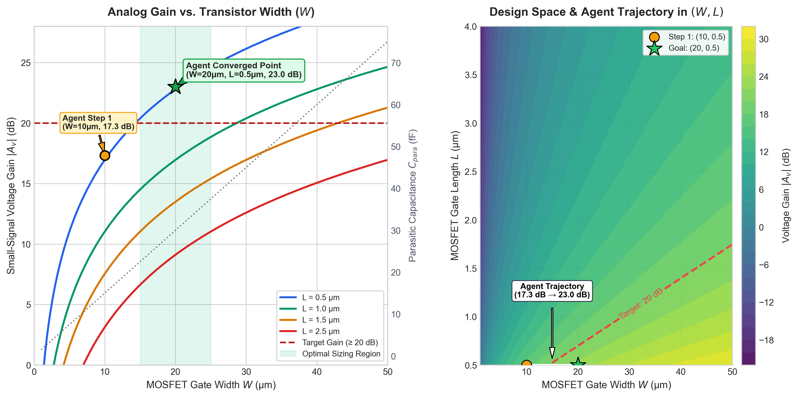

# aina (aa-ee-nah) 🔬⚡

> **AI 4 aNAlog — Autonomous Agentic Transistor Sizing with Real-World SPICE Feedback**  
> *Pronounced "aa-ee-nah"*

[](https://opensource.org/licenses/MIT)
[](https://www.python.org/downloads/)
[](https://ngspice.sourceforge.io/)
[-green.svg)](https://ollama.com/)

---

## What is aina?

**aina** is derived from **AI 4 aNAlog** (spelt and pronounced as *aa-ee-nah*). 

In Eastern philosophy and languages (*آئینہ / आईना*), **aina** translates to **"mirror"** — an intentional homage to the foundational building block of analog integrated circuit design: the *analog current mirror*. Just as a mirror reflects reality with precision, **aina** reflects real SPICE physics, layout parasitics, and device non-linearities directly back into an autonomous agent's reasoning loop.

### The Problem: Why Analog Sizing Needs Agentic AI

Digital VLSI design achieved full automated logic synthesis and place-and-route decades ago. In contrast, **analog IC design remains stubbornly manual**. Sizing transistor dimensions (Gate Width $W$ and Channel Length $L$) is a multi-objective balancing act fraught with non-linear trade-offs:

1. **Transconductance vs. Parasitic Penalty:** Increasing width $W$ raises transconductance ($g_m \propto W/L$), boosting voltage gain. However, wider transistors incur an unavoidable **layout parasitic capacitance penalty** ($C_{parasitic} \approx 1.5 \times W\text{ fF}$) that degrades high-frequency response and bandwidth.
2. **Channel-Length Modulation:** Reducing length $L$ amplifies $W/L$, but degrades transistor output resistance $r_o$ due to channel-length modulation ($\lambda$).
3. **Saturation Guarantees:** Naive numerical optimizers often wander blindly into the triode or cut-off regions, producing nonsensical small-signal gains.

**aina** bridges this gap: it arms an autonomous LLM agent with domain-specific analog IC heuristics, closed-loop SPICE execution via **Ngspice**, and iterative chain-of-thought reflection.

---

## Gain Landscape & Agent Convergence

Below is the small-signal voltage gain landscape computed across the $(W, L)$ design space, showing the non-linear trade-off, the target specification ($\ge 20\text{ dB}$), the layout parasitic capacitance $C_{para}$, and the live convergence trajectory taken by **aina**:



- **Panel 1 (Left):** Voltage gain $|A_v|$ as a function of transistor width $W$ across channel lengths ($L = 0.5, 1.0, 1.5, 2.5\ \mu\text{m}$). The dotted grey line represents the increasing layout parasitic penalty ($C_{para}$). The green shaded band denotes the optimal sizing region where target gain is satisfied while minimizing layout capacitance.
- **Panel 2 (Right):** 2D contour map over $(W, L)$. The agent begins with an initial sizing guess $(W=10\ \mu\text{m}, L=0.5\ \mu\text{m})$ yielding $17.33\text{ dB}$, analyzes the shortfall, and converges to the sweet point $(W=20\ \mu\text{m}, L=0.5\ \mu\text{m})$ achieving **$22.99\text{ dB}$** in just 2 iterations.

---

## System Architecture

```
┌────────────────────────────────────────────────────────────────────────┐
│                                main.py                                 │
│                  Orchestrator — drives the agentic loop                │
└───────────────────────────────────┬────────────────────────────────────┘
                                    │ triggers
                    ┌───────────────▼─────────────────┐
                    │         agent_brain.py          │
                    │   Ollama Local LLM (qwen2.5)    │
                    │   • Analog IC System Prompt     │
                    │   • evaluate_design Tool Schema │
                    │   • Physics-grounded Reasoning  │
                    └───────────────┬─────────────────┘
                                    │ executes tool call
                    ┌───────────────▼─────────────────┐
                    │         circuit_env.py          │
                    │   • Common-Source Amp Netlist   │
                    │   • Layout Penalty: C = 1.5 * W │
                    │   • Real Ngspice or Fast Mock   │
                    └─────────────────────────────────┘
```

### Circuit Physics & Netlist Specs

The environment tests a classic NMOS Common-Source Amplifier with resistive load:

- **Technology:** Level-1 NMOS model ($K_p = 120\ \mu\text{A/V}^2$, $V_{to} = 0.7\text{ V}$, $\lambda = 0.02\text{ V}^{-1}$)
- **Supply & Bias:** $V_{dd} = 3.3\text{ V}$, $V_{bias} = 1.0\text{ V} \implies V_{ov} = V_{gs} - V_{to} = 0.3\text{ V}$ (ensuring saturation across $W \in [1, 50]\ \mu\text{m}$)
- **Load Resistor:** $R_d = 10\text{ k}\Omega$
- **Parasitic Model:** $C_{parasitic}\text{ (fF)} = W\ (\mu\text{m}) \times 1.5$
- **Small-Signal Equations:**
  $$\begin{aligned}
  I_d &= \frac{1}{2} K_p \left(\frac{W}{L}\right) V_{ov}^2 \\
  g_m &= K_p \left(\frac{W}{L}\right) V_{ov} \\
  r_o &= \frac{1}{\lambda I_d} \\
  R_{out} &= R_d \parallel r_o \\
  |A_v| &= g_m \cdot R_{out}
  \end{aligned}$$

---

## Live Agent Execution Trace

Running **aina** locally with Ollama (`qwen2.5:7b`) and real **Ngspice-47**:

```text
  ╔══════════════════════════════════════════╗
  ║              aina  v1.0                  ║
  ║   AI 4 aNAlog: Autonomous SPICE Sizing   ║
  ╚══════════════════════════════════════════╝

  Target gain : >= 20.0 dB
  Max iters   : 10
  LLM model   : qwen2.5:7b
  Sim mode    : ngspice

────────────────────────────────────────────────────────────────────
  Starting agentic loop…

────────────────────────────────────────────────────────────────────
  Iteration 1
────────────────────────────────────────────────────────────────────
           W = 10.00 um
           L = 0.50 um
        Gain = +17.33 dB
      C_para = 15.00 fF
    Sim mode = ngspice

  Agent reasoning:
    The target gain is >= 20 dB. For W=10, L=0.5, the gain is 17.33 dB,
    falling short by 2.67 dB. To achieve the extra gain, we need to
    increase transconductance Gm. Doubling W to 20 um should provide the
    required Gm boost while keeping L at minimum (0.5 um).

────────────────────────────────────────────────────────────────────
  Iteration 2
────────────────────────────────────────────────────────────────────
           W = 20.00 um
           L = 0.50 um
        Gain = +22.99 dB
      C_para = 30.00 fF
    Sim mode = ngspice

  Agent reasoning:
    With W=20 um and L=0.5 um, the simulated gain is 22.99 dB, which
    exceeds the 20 dB specification. Target achieved.

  ✓  Design Verified: Goal Reached  ✓

════════════════════════════════════════════════════════════════════
  RESULTS SUMMARY
════════════════════════════════════════════════════════════════════
  Iter     W (um)    L (um)   Gain (dB)   C_para (fF)  Status
────────────────────────────────────────────────────────────────────
     1      10.00      0.50      +17.33         15.00  SUCCESS
     2      20.00      0.50      +22.99         30.00  ✓ GOAL MET
════════════════════════════════════════════════════════════════════
  Converged in 2 iteration(s). Final: W=20.00 um, L=0.50 um, Gain=22.99 dB
════════════════════════════════════════════════════════════════════
```

---

## Quickstart

### 1. Prerequisites

- **Python 3.9+**
- **Ngspice** (optional, recommended for real SPICE simulation):
  ```bash
  # macOS
  brew install ngspice

  # Ubuntu / Debian
  sudo apt-get install ngspice
  ```
- **Ollama** (for 100% free, local LLM execution):
  ```bash
  # Install Ollama
  brew install ollama   # or download from https://ollama.com

  # Start Ollama service & pull the model
  ollama serve
  ollama pull qwen2.5:7b
  ```

### 2. Clone & Install Dependencies

```bash
git clone https://github.com/0xGu4rdI4N/aina.git
cd aina
pip install -r requirements.txt
```

### 3. Run aina

**Run with local Ollama + real Ngspice:**
```bash
python main.py
```

**Run with analytic mock simulator (no Ngspice required):**
```bash
python main.py --mock
```

**Run with custom target gain or iterations:**
```bash
python main.py --target-gain 22.0 --max-iters 5
```

**Regenerate the parameter landscape plot:**
```bash
python plot_gain.py
```

---

## CLI Options

| Flag | Default | Description |
|------|---------|-------------|
| `--mock` | `off` | Force analytic mock simulator (no Ngspice required) |
| `--model M` | `qwen2.5:7b` | Ollama model name (must support tool use) |
| `--target-gain G` | `20.0` | Target AC voltage gain threshold in dB |
| `--max-iters N` | `10` | Hard cap on agentic feedback iterations |
| `--verbose` | `off` | Enable detailed debug logging |

---

## Repository Structure

```text
aina/
├── assets/
│   └── gain_landscape.png   # Parameter landscape & agent trajectory plot
├── agent_brain.py           # Brain: Ollama agent, tool schema, reasoning trace
├── circuit_env.py           # Environment: SPICE netlist, parasitic model, Ngspice runner
├── main.py                  # Orchestrator: CLI, rich ANSI output, summary reporting
├── plot_gain.py             # Script to generate publication-grade landscape plot
├── requirements.txt         # Dependencies (openai, matplotlib, numpy)
├── .env.example             # Configuration template
├── .gitignore
└── README.md
```

---

## Key Highlights

- ⚡ **100% Local & Free:** Powered by Ollama (`qwen2.5:7b`) and open-source **Ngspice-47**. No cloud API keys or subscriptions required.
- 📐 **Domain-Specific Tool Use:** Strictly bounded parameter schemas prevent physical hallucinations while teaching the model analog trade-offs.
- 🔬 **Physics-Aligned Mock:** Built-in Level-1 MOSFET analytic equations match Ngspice output within $0.2\text{ dB}$, enabling CI/CD testing without external binaries.
- 🛡️ **Defensive Failure Guard:** Automatic out-of-bounds clamping and consecutive failure circuit breakers prevent runaways.

---

## License

MIT © [Raunak Kumar](https://github.com/0xGu4rdI4N)
