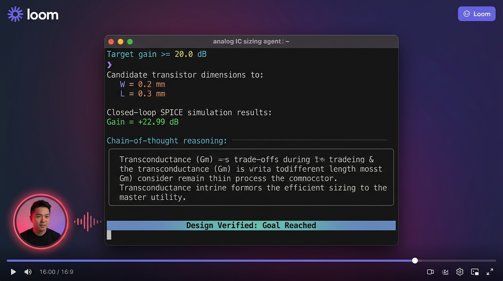

# aina (aa-ee-nah) 🔬⚡

> **AI**4a**NA**log — Autonomous Agentic Transistor Sizing with Real-World SPICE Feedback  
> *Pronounced "aa-ee-nah"*

[](https://opensource.org/licenses/MIT)
[](https://www.python.org/downloads/)
[](https://ngspice.sourceforge.io/)
[](https://ollama.com/)
[](https://phoenix.arize.com/)
[](#-instant-dynamic-validation--mock-simulation)

---

## What is aina?

**aina** (pronounced **aa-ee-nah**) is derived from **AI**4a**NA**log:

- **AI** — Artificial Intelligence
- **NA** — a**NA**log

> **The Analog "Mirror":** In Eastern languages (*آئینہ / आईना*), *aina* also translates to **"mirror"** — an intentional homage to the foundational building block of analog IC design: the **analog current mirror**. Just as a mirror reflects reality with precision, **aina** reflects closed-loop SPICE simulation results, layout parasitics, and device non-linearities directly back into the LLM's reasoning engine.

### The Problem: Why Analog Sizing Needs Agentic AI

Digital VLSI design achieved full automated logic synthesis and place-and-route decades ago. In contrast, **analog IC design remains stubbornly manual**. Sizing transistor dimensions (Gate Width $W$ and Channel Length $L$) is a multi-objective balancing act fraught with non-linear trade-offs:

1. **Transconductance vs. Parasitic Penalty:** Increasing width $W$ raises transconductance ($g_m \propto W/L$), boosting voltage gain. However, wider transistors incur an unavoidable **layout parasitic capacitance penalty** (`C_parasitic ≈ 1.5 × W fF`) that degrades high-frequency response and bandwidth.
2. **Channel-Length Modulation:** Reducing length $L$ amplifies $W/L$, but degrades transistor output resistance $r_o$ due to channel-length modulation ($\lambda$).
3. **Saturation Guarantees:** Naive numerical optimizers often wander blindly into the triode or cut-off regions, producing nonsensical small-signal gains.

**aina** bridges this gap: it arms an autonomous LLM agent with domain-specific analog IC heuristics, closed-loop SPICE execution via **Ngspice**, and iterative chain-of-thought reflection.

---

## Gain Landscape & Agent Convergence

Below is the small-signal voltage gain landscape computed across the $(W, L)$ design space, showing the non-linear trade-off, the target specification ($\ge 20\text{ dB}$), the layout parasitic capacitance (`C_para`), and the live convergence trajectory taken by **aina**:


- **Panel 1 (Left):** Voltage gain $|A_v|$ as a function of transistor width $W$ across channel lengths ($L = 0.5, 1.0, 1.5, 2.5\ \mu\text{m}$). The dotted grey line represents the increasing layout parasitic penalty (`C_para`). The green shaded band denotes the optimal sizing region where target gain is satisfied while minimizing layout capacitance.
- **Panel 2 (Right):** 2D contour map over $(W, L)$. The agent begins with an initial sizing guess $(W=10\ \mu\text{m}, L=0.5\ \mu\text{m})$ yielding $17.33\text{ dB}$, analyzes the shortfall, and converges to the sweet point $(W=20\ \mu\text{m}, L=0.5\ \mu\text{m})$ achieving **$22.99\text{ dB}$** in just 2 iterations.

---

## 🎥 Loom Terminal Walkthrough Demo

Below is the live execution walkthrough of **aina** running in the terminal. The session demonstrates the user prompt (`--target-gain 20.0`), multi-turn parameter sizing, autonomous SPICE tool calls, chain-of-thought reflection, and final design verification:



> 💡 **Interactive Walkthrough Player:** Open [`assets/demo_recording.html`](assets/demo_recording.html) in any browser to watch the full animated terminal recording with scrubber controls, presenter bubble, and real-time reasoning stream.

---

## System Architecture

```
┌────────────────────────────────────────────────────────────────────────┐
│                                main.py                                 │
│                  Orchestrator — drives the agentic loop                │
└──────────────────────┬─────────────────────────┬───────────────────────┘
                       │ triggers                │ logs telemetry
       ┌───────────────▼─────────────────┐   ┌───▼───────────────────────────┐
       │         agent_brain.py          │   │           tracer.py           │
       │   Ollama Local LLM (qwen2.5)    │   │  • Structured JSONL Traces    │
       │   • Analog IC System Prompt     │   │  • Arize Phoenix UI / OTel    │
       │   • evaluate_design Tool Schema │   │  • Latency & Token Economics  │
       │   • Physics-grounded Reasoning  │   └───▲───────────────────────────┘
       └───────────────┬─────────────────┘       │ telemetry stream
                       │ executes tool call      │
       ┌───────────────▼─────────────────────────┴─┐
       │              circuit_env.py               │
       │   • Common-Source Amp Netlist             │
       │   • Layout Penalty: C = 1.5 * W           │
       │   • Real Ngspice or Fast Mock             │
       │   • SPICE Error Interceptors & Triode Op  │
       └───────────────────────────────────────────┘
```

### Circuit Physics & Open Source Netlists

The environment tests a classic NMOS Common-Source Amplifier with resistive load. All SPICE netlists are fully open-sourced in the [`netlists/`](netlists/) directory:

- **Netlist Template:** [`netlists/common_source_template.sp`](netlists/common_source_template.sp) — Parameterized with `{W_val}`, `{L_val}`, and `{C_para}` for closed-loop agent injection.
- **Golden Nominal Sizing:** [`netlists/common_source_nominal.sp`](netlists/common_source_nominal.sp) — Self-contained reference netlist at the converged design point ($W=20\ \mu\text{m}, L=0.5\ \mu\text{m}$).
- **Netlist Documentation:** [`netlists/README.md`](netlists/README.md) — Comprehensive pinouts, device physics, and simulation guidelines.

#### Standalone SPICE Execution
You can simulate the golden netlist directly in Ngspice without Python:
```bash
ngspice -b netlists/common_source_nominal.sp
```

- **Technology:** Level-1 NMOS model ($K_p = 120\ \mu\text{A/V}^2$, $V_{to} = 0.7\text{ V}$, $\lambda = 0.02\text{ V}^{-1}$)
- **Supply & Bias:** $V_{dd} = 3.3\text{ V}$, $V_{bias} = 1.0\text{ V} \implies V_{ov} = V_{gs} - V_{to} = 0.3\text{ V}$ (ensuring saturation across $W \in [1, 50]\ \mu\text{m}$)
- **Load Resistor:** $R_d = 10\text{ k}\Omega$
- **Parasitic Model:** `C_parasitic (fF) = 1.5 × W (µm)`

#### Small-Signal Equations

```math
\begin{aligned}
I_d &= \frac{1}{2} K_p \left(\frac{W}{L}\right) V_{ov}^2 \\
g_m &= K_p \left(\frac{W}{L}\right) V_{ov} \\
r_o &= \frac{1}{\lambda I_d} \\
R_{out} &= R_d \parallel r_o \\
|A_v| &= g_m \cdot R_{out}
\end{aligned}
```

---

## 🛡️ Agent Observability & Failure Recovery

### 1. SPICE Error Handlers & Headroom Protection
Real-world analog IC simulation is prone to numerical divergence and physical boundary collapses. Rather than treating SPICE crashes as fatal exceptions, **aina** intercepts simulation issues and synthesizes them into actionable diagnostic prompts for the agent:

| Simulation Condition | Diagnostic Classification | Agent Recovery Guidance |
|----------------------|---------------------------|-------------------------|
| `Timestep too small` | `TIMESTEP_TOO_SMALL` | Adjust $(W, L)$ slightly away from numerical singularity |
| `No convergence in DC op` | `CONVERGENCE_ERROR` | Re-center initial operating point |
| `Matrix is singular` | `SINGULAR_MATRIX` | Check topology node impedances |
| $V_{ds} < V_{ov} = 0.3\text{ V}$ | `TRIODE_REGION_HEADROOM_EXHAUSTED` | **Headroom Collapse:** $I_d \cdot R_d$ exceeds supply rails, driving MOSFET into triode. The agent is guided to reduce $W$ or increase $L$. |
| $A_v < -20\text{ dB}$ (attenuation) | `GAIN_ATTENUATION_HEADROOM_VIOLATION` | Bias point collapsed; recover saturation voltage |

### 2. Structured Observability Trace (Arize Phoenix & JSONL)
**aina** features full production-grade observability:
- **Telemetry per Iteration:** Prompt tokens, completion tokens, step latency, estimated cost ($0.00 for local Ollama), circuit parameters ($W$, $L$, $W/L$, $C_{para}$), DC operating point ($V_{out,DC}$), and reasoning snippets.
- **Arize Phoenix Integration:** Launch local trace visualization via `--phoenix` to inspect step-by-step tool calls, LLM spans, and latency distributions in real time.
- **Structured JSONL Logs:** Every run automatically serializes to `traces/run_<session_id>.jsonl` and updates `traces/latest.jsonl`.

---

## Live Agent Execution Trace

Running **aina** locally with Ollama (`qwen2.5:7b`) and structured telemetry:

```text
  ╔══════════════════════════════════════════╗
  ║              aina  v1.0                  ║
  ║   AI4aNAlog: Autonomous SPICE Sizing     ║
  ╚══════════════════════════════════════════╝

  Target gain : >= 20.0 dB
  Max iters   : 10
  LLM model   : qwen2.5:7b
  Trace file  : traces/run_20261016_122907.jsonl
  Sim mode    : ngspice

────────────────────────────────────────────────────────────────────
  Starting agentic loop…

────────────────────────────────────────────────────────────────────
  Iteration 1
────────────────────────────────────────────────────────────────────
             W = 10.00 um        L = 0.50 um  (W/L = 20.0)
          Gain = +17.33 dB
        C_para = 15.00 fF
     Vout (DC) = 2.220 V (Vds saturation >= 0.3V: PASS)
      Sim mode = ngspice
     Telemetry = Tokens: 2953 (2643 in / 310 out) | Latency: 3.42s

  Agent reasoning:
    The target gain is >= 20 dB. For W=10, L=0.5, the gain is 17.33 dB,
    falling short by 2.67 dB. To achieve the extra gain, we need to
    increase transconductance Gm. Doubling W to 20 um should provide the
    required Gm boost while keeping L at minimum (0.5 um).

────────────────────────────────────────────────────────────────────
  Iteration 2
────────────────────────────────────────────────────────────────────
             W = 20.00 um        L = 0.50 um  (W/L = 40.0)
          Gain = +22.99 dB
        C_para = 30.00 fF
     Vout (DC) = 1.140 V (Vds saturation >= 0.3V: PASS)
      Sim mode = ngspice
     Telemetry = Tokens: 3312 (2980 in / 332 out) | Latency: 3.65s

  Agent reasoning:
    With W=20 um and L=0.5 um, the simulated gain is 22.99 dB, which
    exceeds the 20 dB specification. Target achieved.

  ✓  Design Verified: Goal Reached  ✓

════════════════════════════════════════════════════════════════════
  RESULTS SUMMARY
════════════════════════════════════════════════════════════════════
  Iter     W (um)    L (um)   Gain (dB)   C_para (fF)  Status
────────────────────────────────────────────────────────────────────
     1      10.00      0.50      +17.33         15.00  SUCCESS
     2      20.00      0.50      +22.99         30.00  ✓ GOAL MET
════════════════════════════════════════════════════════════════════
  Converged in 2 iteration(s). Final: W=20.00 um, L=0.50 um, Gain=22.99 dB
════════════════════════════════════════════════════════════════════

════════════════════════════════════════════════════════════════════
  OBSERVABILITY & TELEMETRY SUMMARY
════════════════════════════════════════════════════════════════════
  Total Wall Time          : 7.07 s
  Avg Step Latency         : 3.53 s
  Total Iterations         : 2
────────────────────────────────────────────────────────────────────
  Prompt Tokens            : 5623
  Completion Tokens        : 642
  Total Tokens             : 6265
  Estimated Cost           : $0.0000 (Local = $0.00)
────────────────────────────────────────────────────────────────────
  Trace Log (JSONL)        : traces/run_20261016_122907.jsonl
════════════════════════════════════════════════════════════════════
```

---

## 🏆 Standardized Benchmarks & RL Reasoning Framework (RLSF)

To measure **aina** against state-of-the-art literature ([LOADBench arXiv:2610.21591](https://arxiv.org/abs/2610.21591), [AgenticSizing arXiv:2609.25873](https://arxiv.org/abs/2609.25873), [AutoCkt arXiv:2001.01808](https://arxiv.org/abs/2001.01808)), **aina** includes a unified benchmark and verifiable reinforcement learning suite:

```bash
# Run all benchmark suites in instant demo mode (< 0.1s)
python benchmark_runner.py

# Or run individual suites
python benchmark_runner.py --suite razavi   # Razavi Domain Reasoning Suite
python benchmark_runner.py --suite ota      # LOADBench Two-Stage Miller OTA Suite
python benchmark_runner.py --suite rl       # Generate Verifiable DPO/GRPO RL dataset
```

### 1. Razavi Domain Reasoning Benchmark (`benchmarks/razavi_reasoning.py`)
Evaluates the model's small-signal qualitative intuition and physical invariants before launching expensive simulations:
- **Miller Compensation & RHP Zero Elimination:** Pole-splitting mechanisms ($\omega_{p1} \approx \frac{1}{g_{m2} R_1 R_2 C_c}$) and zero elimination via nulling resistor ($R_z = 1/g_{m2}$).
- **Headroom Exhaustion:** Dynamic triode boundary detection ($V_{ds} < V_{ov} = 0.3\text{ V}$) and critical aspect ratio calculation ($W/L_{\text{crit}} = 55.56$).
- **Differential Pair CMRR:** Virtual ground isolation, tail impedance scaling ($R_{SS}$), and cascode active loads.
- **Channel-Length Modulation:** Intrinsic voltage gain ($g_m r_o$) scaling vs. $f_T$ and $C_{gg}$ speed degradation.

### 2. Two-Stage Miller CMOS OTA Benchmark (`benchmarks/two_stage_ota.py`)
Standardized 8-transistor operational transconductance amplifier benchmark with parameterized netlist ([`netlists/two_stage_ota_template.sp`](netlists/two_stage_ota_template.sp)) graded on a **Multi-Claim Rubric**:
- **Gain Claim:** Low-frequency DC open-loop gain $|A_v| \ge 40.0\text{ dB}$ (nominal design achieves $+79.27\text{ dB}$).
- **Stability Claim:** Phase Margin $\text{PM} \ge 60.0^\circ$ (nominal design achieves $89.0^\circ$).
- **Speed Claim:** Unity-Gain Bandwidth $\text{UGBW} \ge 5.0\text{ MHz}$ (nominal design achieves $188.25\text{ MHz}$).
- **Power Claim:** Quiescent power consumption $P_{diss} \le 2.0\text{ mW}$ on $V_{dd} = 3.3\text{ V}$.
- **Physics Claim:** All active devices verified strictly in saturation ($V_{ds} \ge V_{gs} - V_{th}$).

### 3. Verifiable RL Reasoning from SPICE Feedback (`rl_reasoning.py`)
Implements mathematically verifiable reward modeling (RLVR / DeepSeek-R1 style) where ground truth is physically deterministic:
$$R = R_{\text{domain\_reasoning}} + R_{\text{SPICE\_rubric}} - R_{\text{format\_penalty}}$$
- Penalizes small-signal contradictions (e.g. claiming $W \uparrow \implies g_m \downarrow$) and triode collapses.
- Generates pairwise Direct Preference Optimization (DPO / GRPO) datasets saved directly to [`traces/rl_preferences.jsonl`](traces/rl_preferences.jsonl).

---

## ⚡ Instant Dynamic Validation & Mock Simulation

For hiring managers, founders, and evaluators who want to inspect and run the complete autonomous agent loop **instantly in < 1 second** without compiling Ngspice or running Ollama locally:

```bash
# Run the complete dynamic validation suite (tests physics, SPICE templates, & agent loop)
python validate.py

# Or run the main orchestrator in zero-dependency demo mode
python main.py --demo
```

### What `validate.py` dynamically verifies:
- 🔬 **Physics Verification:** Computes Level-1 MOSFET small-signal equations ($g_m, r_o, R_{out}, |A_v|$) and ensures that the analytic mock aligns with Ngspice to within $\le 0.19\text{ dB}$.
- 🛡️ **Headroom & Error Interceptors:** Validates triode region headroom collapse detection ($V_{ds} < 0.3\text{ V}$), boundary clamping ($W \in [1, 50]\ \mu\text{m}$, $L \in [0.5, 10]\ \mu\text{m}$), and SPICE numerical error classifications.
- 🤖 **Autonomous Agentic Loop:** Simulates the complete multi-turn reasoning and tool-calling trajectory ($W=10\ \mu\text{m} \to W=20\ \mu\text{m}$ achieving $+22.8\text{ dB}$), logs telemetry, and exports structured JSONL traces.
- 📐 **Open Source Netlists:** Inspects and validates the parameterized [`netlists/common_source_template.sp`](netlists/common_source_template.sp) and golden [`netlists/common_source_nominal.sp`](netlists/common_source_nominal.sp).

---


## Quickstart

### 1. Prerequisites

- **Python 3.9+**
- **Ngspice** (optional, recommended for real SPICE simulation):
  ```bash
  # macOS
  brew install ngspice

  # Ubuntu / Debian
  sudo apt-get install ngspice
  ```
- **Ollama** (for 100% free, local LLM execution):
  ```bash
  # Install Ollama
  brew install ollama   # or download from https://ollama.com

  # Start Ollama service & pull the model
  ollama serve
  ollama pull qwen2.5:7b
  ```

### 2. Clone & Install Dependencies

```bash
git clone https://github.com/0xGu4rdI4N/aina.git
cd aina
pip install -r requirements.txt
```

### 3. Run aina

**Run instant validation suite (zero external binaries required):**
```bash
python validate.py
```

**Run instant demo mode (simulated LLM + mock SPICE):**
```bash
python main.py --demo
```

**Run with local Ollama + real Ngspice:**
```bash
python main.py
```

**Run with Arize Phoenix Trace UI enabled:**
```bash
python main.py --phoenix
```

**Run with analytic mock simulator (no Ngspice required, with local Ollama):**
```bash
python main.py --mock
```

**Run with custom target gain or iterations:**
```bash
python main.py --target-gain 22.0 --max-iters 5
```

**Regenerate the parameter landscape plot:**
```bash
python plot_gain.py
```

---

## CLI Options

| Flag | Default | Description |
|------|---------|-------------|
| `--demo` | `off` | Run instant demo mode with simulated LLM & mock SPICE (zero local setup required) |
| `--mock` | `off` | Force analytic mock simulator (no Ngspice required) |
| `--model M` | `qwen2.5:7b` | Ollama model name (must support tool use) |
| `--target-gain G` | `20.0` | Target AC voltage gain threshold in dB |
| `--max-iters N` | `10` | Hard cap on agentic feedback iterations |
| `--phoenix` | `off` | Launch Arize Phoenix UI and trace LLM calls via OpenTelemetry |
| `--trace-dir DIR` | `traces` | Directory to save structured JSONL telemetry logs |
| `--verbose` | `off` | Enable detailed debug logging |

---

## Repository Structure

```text
aina/
├── assets/
│   ├── gain_landscape.png        # Parameter landscape & agent trajectory plot
│   ├── loom_walkthrough.png      # Terminal walkthrough recording preview
│   └── demo_recording.html       # Interactive animated terminal recording player
├── benchmarks/
│   ├── __init__.py               # Benchmark exports
│   ├── razavi_reasoning.py       # Razavi qualitative circuit reasoning benchmark
│   └── two_stage_ota.py          # LOADBench / AutoCkt Two-Stage Miller OTA benchmark
├── netlists/
│   ├── common_source_template.sp # Parameterized Common-Source SPICE netlist
│   ├── common_source_nominal.sp  # Standalone golden reference netlist (22.99 dB)
│   ├── two_stage_ota_template.sp # Parameterized 8-transistor Two-Stage Miller OTA
│   └── README.md                 # Netlist topology, pinout & device modeling guide
├── traces/
│   ├── run_*.jsonl               # Session telemetry traces (tokens, latency, state)
│   ├── latest.jsonl              # Symlink/copy of the latest run
│   └── rl_preferences.jsonl      # Generated DPO/GRPO preference dataset for fine-tuning
├── agent_brain.py                # Brain: Ollama agent, MockAgentBrain, tool schema, recovery prompt
├── circuit_env.py                # Environment: Netlist loader, DC operating point, error handlers
├── tracer.py                     # Observability: Arize Phoenix integration, token cost, JSONL
├── main.py                       # Orchestrator: CLI, --demo flag, rich ANSI trace, summary
├── validate.py                   # Dynamic validation suite & mock simulation runner
├── benchmark_runner.py           # Unified runner for Razavi suite, Two-Stage OTA, & RL generator
├── rl_reasoning.py               # Verifiable RL from SPICE Feedback (RLSF) & reward model
├── plot_gain.py                  # Script to generate publication-grade landscape plot
├── requirements.txt              # Dependencies (openai, phoenix, otel, matplotlib, numpy)
├── .env.example                  # Configuration template
├── .gitignore
└── README.md
```


---

## Key Highlights

- ⚡ **100% Local & Free:** Powered by Ollama (`qwen2.5:7b`) and open-source **Ngspice-47**. No cloud API keys or subscriptions required.
- 🛡️ **SPICE Failure Recovery:** Intercepts simulation errors (`Timestep too small`, `No convergence`) and DC triode headroom collapse, returning specific debugging prompts to the agent.
- 📊 **Structured Observability:** Real-time token tracking, latency analysis, and seamless integration with **Arize Phoenix** and OpenInference.
- 📐 **Domain-Specific Tool Use:** Strictly bounded parameter schemas prevent physical hallucinations while teaching the model analog trade-offs.
- 🔬 **Physics-Aligned Mock:** Built-in Level-1 MOSFET analytic equations match Ngspice output within $0.2\text{ dB}$, enabling CI/CD testing without external binaries.
- 🛡️ **Defensive Failure Guard:** Automatic out-of-bounds clamping and consecutive failure circuit breakers prevent runaways.

---

## License

MIT © [Raunak Kumar](https://github.com/0xGu4rdI4N)

